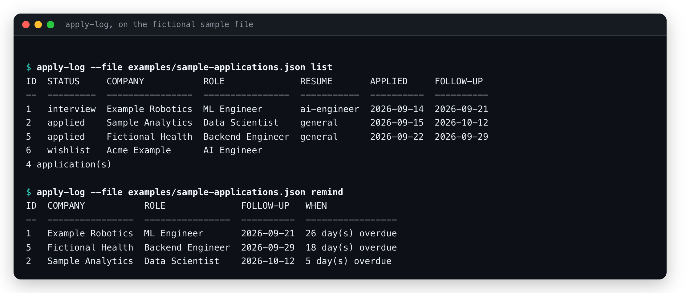

# apply-log

A private job-hunt tracker for the command line. It keeps every application in one JSON file on your own machine: the company and role, **which resume variant you sent**, where you found it, what happened and when, and when to follow up. It tells you what is due, shows which resume variants and sources got replies, and writes your follow-ups as a CSV that Todoist can import.

It is one Python file with no dependencies, it never sends anything anywhere, and it keeps your data out of the repository.



*A real run on the fictional sample file in `examples/`. The text output below is from an earlier day, so the overdue counts differ.*

```text
$ apply-log list
ID  STATUS     COMPANY           ROLE              RESUME       APPLIED     FOLLOW-UP
--  ---------  ----------------  ----------------  -----------  ----------  ----------
1   interview  Example Robotics  ML Engineer       ai-engineer  2026-09-14  2026-09-21
2   applied    Sample Analytics  Data Scientist    general      2026-09-15  2026-10-12
5   applied    Fictional Health  Backend Engineer  general      2026-09-22  2026-09-29
6   wishlist   Acme Example      AI Engineer
4 application(s)

$ apply-log remind --within 7
ID  COMPANY           ROLE              FOLLOW-UP   WHEN
--  ----------------  ----------------  ----------  -----------------
1   Example Robotics  ML Engineer       2026-09-21  22 day(s) overdue
5   Fictional Health  Backend Engineer  2026-09-29  14 day(s) overdue
2   Sample Analytics  Data Scientist    2026-10-12  1 day(s) overdue
```

(That output is from `examples/sample-applications.json`, a file of fictional companies built by running the real commands on different days.)

## Use

```bash
python apply_log.py add "Acme" "ML Engineer" --resume ai-engineer --source LinkedIn --url https://...
python apply_log.py add "Globex" "Backend Engineer" --status wishlist       # not applied yet
python apply_log.py update 1 --status screening --note "call with Sam on Friday"
python apply_log.py follow 1 --note "emailed the recruiter"                  # logs it and schedules the next one
python apply_log.py remind                                                   # what is due today or overdue
python apply_log.py stats                                                    # replies by resume variant and source
python apply_log.py export-todoist --out reminders.csv                       # follow-ups for Todoist
```

After `pip install .` the command is called `apply-log`. Try it on the sample data without touching your own: `python apply_log.py --file examples/sample-applications.json list`.

## What it keeps and does

Every application has a **status** (`wishlist`, `applied`, `screening`, `interview`, `offer`, `accepted`, `rejected`, `withdrawn`, `ghosted`), the date you applied, a follow-up date, and a **history** of everything that happened to it, so the numbers below can be worked out later.

- **Follow-ups:** a new application gets a follow-up date a week after you applied (change it with `--follow-up`). `follow` logs that you followed up and schedules the next one; after the third follow-up with no change it suggests marking the application `ghosted`. Closing an application (`accepted`, `rejected`, `withdrawn`, `ghosted`) clears its follow-up date.
- **`remind [--within N] [--json]`:** open applications whose follow-up is due, overdue (with how many days) or coming up in the next N days.
- **`stats`:** how many you sent, how many **replied** (including rejections, because a no is still an answer), how many **moved you forward** (screen or beyond), the median days to a first reply, and the same split by resume variant and by source. Groups under 5 applications are labelled "too few to compare", because with so few the differences are noise.
- **`check`:** validates the file and points out applications that have no follow-up date or have not changed for 30 days.
- **`list`** (open applications by default; `--all`, `--status`, `--company`, `--resume`, `--source`, `--json`), **`show`** (one application with its history), **`update`**, **`remove --yes`**, **`export`** (CSV or JSON; optionally `--open-only`).
- Dates can be written `2026-11-03`, `today`, `tomorrow`, `+3d` or `+2w`.

### Todoist

`export-todoist` writes one task per open application whose follow-up falls within `--within` days (default 14), named "Follow up: Company, Role", with the date, the status, the resume variant and the link in the description:

```text
TYPE,CONTENT,DESCRIPTION,PRIORITY,INDENT,AUTHOR,RESPONSIBLE,DATE,DATE_LANG,TIMEZONE
task,"Follow up: Sample Analytics, Data Scientist",apply-log #2 | status applied | resume general,3,1,,,2026-10-12,en,
```

The columns follow Todoist's CSV import template as I know it. I have not imported this file into Todoist myself, so check the columns against Todoist's current import help the first time. Importing the same file twice creates the tasks twice. Names that start with `=`, `+`, `-` or `@` are prefixed with an apostrophe so a spreadsheet does not run them as formulas.

## Your data

By default everything is stored in `~/.apply-log/applications.json` (set another place with `--file` or `APPLY_LOG_FILE`). The folder is private to your user and the file is written atomically, so a crash cannot leave a half-written file; a file that cannot be read is reported and never overwritten. The file holds personal information (employers, contacts, notes), so back it up somewhere private and never commit it: `.gitignore` already excludes `applications.json`.

`APPLY_LOG_TODAY=YYYY-MM-DD` makes the tool behave as if it were that day, which is how the sample file and the tests are reproducible.

## Tests

```bash
python -m unittest discover -s tests
```

47 tests, offline, using temporary files: date parsing, validation, every command and its error cases, history and status rules, the reply statistics, the Todoist and CSV export (including formula safety), file privacy, atomic writes and damaged files. CI runs them on Python 3.9 and 3.12 with a lint step.

## Limits you should know about

- **It is a notebook, not a service.** One user, one file, no syncing and no locking: do not run two commands at the same moment. Nothing is sent to employers or to Todoist.
- **The statistics are only as good as the dates you enter,** and small numbers say little. A resume variant that "got more replies" after five applications has told you almost nothing. Replies can also depend on the role, the company and the time of year more than on the resume.
- "Replied" means you moved the status; the tool cannot see your inbox.
- The Todoist export has not been tried against a real Todoist account, and there is no direct API push.
- Follow-up rules (a week, three tries) are defaults I chose, not advice from a study.

## Notes

Written with AI assistance (Claude Code); the idea and the review of the behaviour are mine.

## License

MIT
